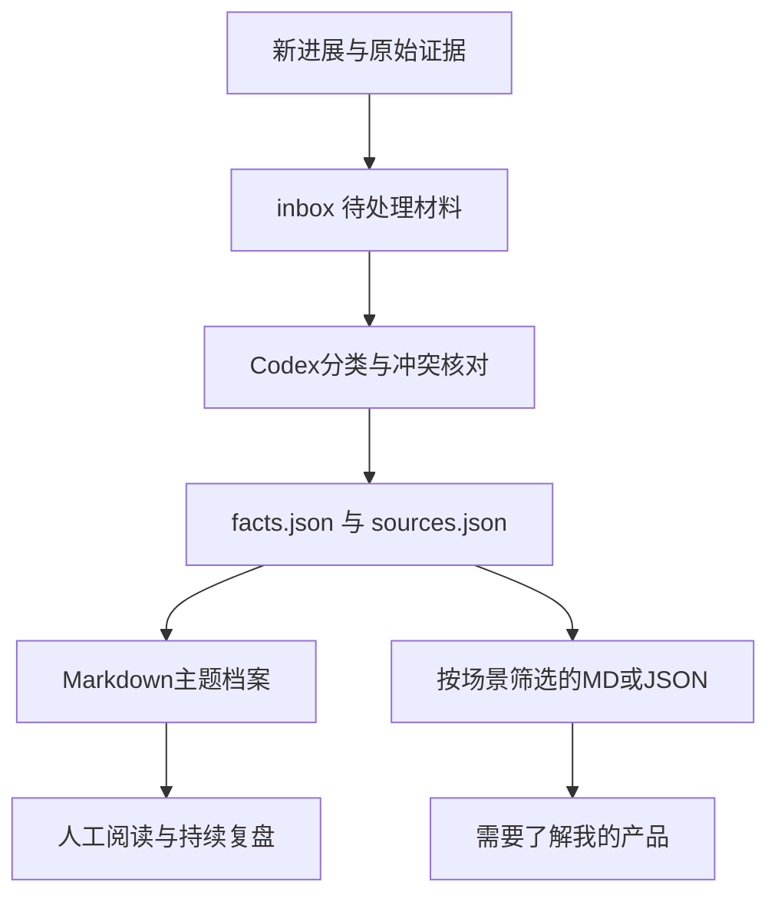

# Elvis Context OS

**给 AI 使用的个人数字档案与持续更新文档系统。**

以可迁移的 Markdown + JSON 保存职业背景、两家公司、OfficeFlow、工程资料自动化、技术、英语、商业、内容品牌、习惯、目标与探索。让一个新的产品或 AI 助手可以迅速理解我，并知道哪些内容已确认、哪些是历史记录、哪些仍在计划中。

本仓库是**私有主档案**。内容截止于 **2026-10-20**，首版有 **185 条记录、14 个来源、14 个主题档案**。覆盖可访问的历史，不声称已获得多年全部对话。姓名、公司法定名称、最新产品版本、收入和成果存在明确待补项。

## 现在开始

- **交给 Codex：** [CODEX_START_HERE.md](CODEX_START_HERE.md)
- **先了解我：** [CURRENT.md](CURRENT.md) → [通用上下文](contexts/general.md)
- **全面了解我：** [完整日常上下文](contexts/full.md)，默认不含 restricted 记录
- **查具体细节：** [档案导航](docs/INDEX.md)、[时间线](docs/TIMELINE.md)、[来源](docs/SOURCES.md)
- **随时更新：** [维护流程](docs/MAINTENANCE.md)、[更新模板](templates/update.md)
- **接入其他产品：** [集成说明](integrations/README.md)

## 用途与入口

| 场景 | 推荐读取 | 可生成的结构化范围 |
| --- | --- | --- |
| 新助手首次了解我 | `CURRENT.md` + `contexts/general.md` | `general` |
| 软件开发、Codex执行 | `AGENTS.md` + `contexts/coding.md` | `coding` |
| OfficeFlow产品与推广 | `contexts/officeflow.md` | `officeflow` |
| 隧道资料、工程自动化 | `contexts/engineering.md` | `engineering` |
| 双公司经营、商业化 | `contexts/business.md` | `business` |
| 英语和技术表达 | `contexts/english.md` | `english` |
| 自媒体、演示与教程 | `contexts/content.md` | `content` |
| REA、交易与研究 | `contexts/research.md` | `research` |
| 完整私有复盘 | `data/facts.json` + `docs/` | `full --audience restricted` |

## 运行

只需 Python 3.10+ 标准库；不需要 API Key、数据库、付费服务或模型调用。Windows 可以把 `python3` 换成 `py -3`；macOS/Linux 通常使用 `python3`。以下命令均在仓库根目录运行。

```bash
python3 scripts/context.py validate
python3 -m unittest discover -s tests -v
python3 scripts/context.py build --as-of 2026-10-20
python3 scripts/context.py export --profile officeflow --output exports/officeflow.md
python3 scripts/context.py export --profile engineering --format json --output exports/engineering.json
python3 scripts/context.py export --profile general --max-facts 20 --output exports/quick.md
```

生成文件的日期应使用本次复核日。事实本身的 `observed_at` 保留原日期。`--max-facts` 按优先级选择完整记录并报告省略数量，不宣称等于模型Token预算。导出不会自动发送给任何产品。

## 结构



| 路径 | 职责 |
| --- | --- |
| `data/facts.json` | 个人事实、偏好、目标、约束、未知与变化记录的唯一事实源 |
| `data/sources.json` | 来源类型、日期、定位与证据边界 |
| `data/projects.json` | 项目关系与事实ID导航，不再复制事实正文 |
| `data/fact.schema.json` | 事实格式说明；运行时校验由Python脚本执行 |
| `docs/` | 主题档案、时间线、到期复核、维护规范 |
| `contexts/` | 由事实源生成的日常上下文包 |
| `integrations/` | 产品接入契约与通用引导提示 |
| `templates/`、`prompts/` | 更新模板、补历史与维护提示词 |
| `scripts/`、`tests/` | 校验、导出、生成与行为测试 |
| `.github/workflows/` | 只读校验、测试与生成一致性检查 |

## 更新一句话就够

把新进展和相关文件交给 Codex，并说：

> 请按本仓库 CODEX_START_HERE.md 更新我的数字档案。保留来源和日期，区分事实、计划与推断，处理旧状态，重新生成相关上下文并运行校验，最后告诉我哪些内容发生变化。

系统不会自动获得所有新聊天。新信息需要本人提供，或由已授权的连接器明确读取。GitHub提供版本历史；它不是跨所有AI产品的自动记忆同步服务。

## 使用边界

旧收入不能当成当前余额；询问实盘交易不能当成已盈利；发布说明书不能证明所有功能已验收；“能力目标75%”不能当成已达成。AI读到这些背景，也不能据此获得发送消息、交易或修改其他系统的授权。

整仓库包含私密数据。`private/restricted/public`是**导出筛选标签**，不是仓库内访问隔离或加密。对外复用请只交付经过筛选的导出文件，不直接公开主仓库。公开导出需逐条设置 `sensitivity=public` 与 `public_approved=true`；首版没有预批准公开记录。
